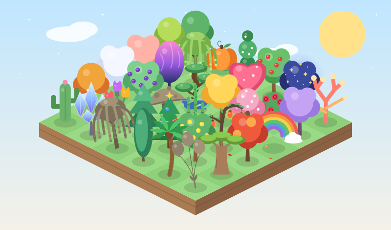
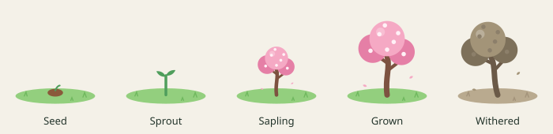
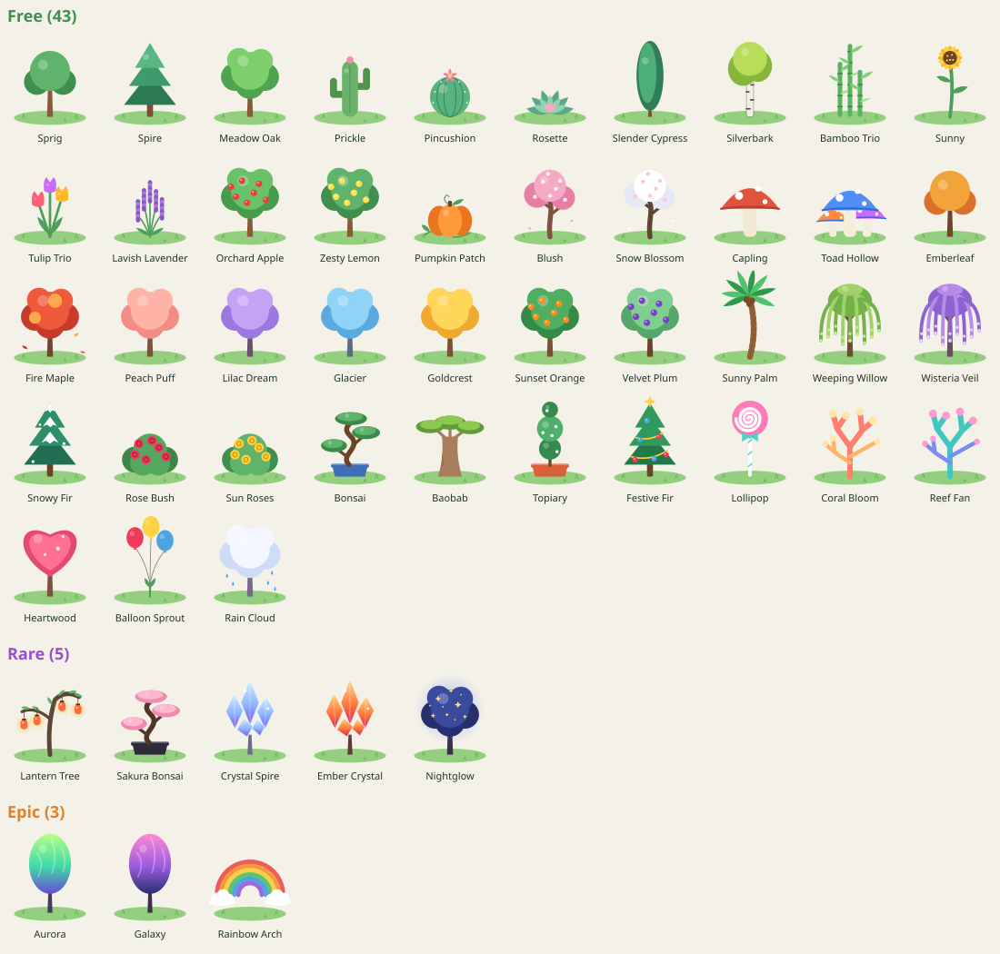

# 🌱 Grove

**Stay focused. Grow a garden.**

Grove is a focus timer that grows a plant while you work. Start a session and a seed sprouts, then grows into a full plant by the time the timer ends. Give up, or wander off to a distracting site, and it withers. Over time your focus sessions fill a garden you can look back on.

It comes as a **website** and a **Chrome extension**. They share one codebase, with plain HTML, CSS and JavaScript and no build step.

<p align="center">
  
</p>

## Features

- ⏳ **Focus timer.** Choose 5 to 180 minutes. Your plant grows from seed to sprout to sapling to full size in real time.
- 🚫 **Site blocking (extension).** Sites on your block list redirect to a "stay focused" page until the session ends.
- 🥀 **Real stakes.** Give up, or leave the web app's tab for longer than the grace period, and your plant withers. It stays in your garden as a reminder.
- 🏝️ **Garden view.** Your plants appear on an island you can view by day, week, month, year or all time, with stats for each period.
- 🌈 **51 original species.** 43 are free from day one. The other 8 rare and epic species are earned by hitting focus milestones.
- 📊 **Stats and streaks.** Total focus time, a 7-day chart, time per tag, current and best streaks.
- 🏷️ **Tags.** Label sessions as Study, Work, Reading, or anything you like.
- 🔒 **Private by design.** Everything is stored on your own device. There are no accounts, tracking or servers.

<p align="center">
  
</p>

---

## Quick start

You need **Python 3** (preinstalled on macOS and most Linux systems) and, optionally, **Node.js** for the helper scripts. There are no dependencies to install.

```sh
git clone https://github.com/AlapanDas/grove.git
cd grove
```

### Run the website locally

```sh
npm run dev
```

Or, without npm:

```sh
./scripts/sync-shared.sh
python3 -m http.server 5173 -d web
```

Open **http://localhost:5173**. The landing page is `index.html`, and **Start focusing** takes you to the app. Press `Ctrl+C` in the terminal to stop the server.

> The website has to be served over `http://`. Opening `web/index.html` directly from the file system won't work, because browsers block JavaScript modules on `file://` URLs.

### Install the Chrome extension (developer mode)

1. Open **`chrome://extensions`** in Chrome (or any Chromium browser, such as Edge, Brave or Arc).
2. Turn on **Developer mode** (top-right toggle).
3. Click **Load unpacked** and select the **`extension/`** folder in this repo.
4. Click the puzzle-piece icon in the toolbar and **pin 🌱 Grove**.

After you change the code, run `npm run sync`, then click the **↻ reload** button on Grove's card in `chrome://extensions`.

---

## How to use it

### 1. Plant a session

Open the extension popup (click 🌱 in the toolbar) or the web app.

1. Drag the slider to choose how long you want to focus (5 to 180 minutes).
2. Choose a **species** and, optionally, a **tag**.
3. Click **Plant & focus**.

Your plant starts as a seed and grows as the timer counts down.

### 2. Stay focused

| | Website | Chrome extension |
|---|---|---|
| **What counts as leaving** | Switching away from the tab for longer than the grace period (10 seconds by default) | Opening a site on your block list |
| **What happens** | Your plant withers | The site is blocked and you see your growing plant and the time left |
| **Giving up** | Click **Give up**, and the plant withers | Click **Give up** in the popup or on the blocked page, and the plant withers and the sites unblock |

When the timer ends, the plant joins your garden. The extension also shows a desktop notification.

### 3. Explore your progress

Open the full app. In the extension, click **Open garden, stats & collection →** in the popup. On the website, scroll below the timer.

| Tab | What it shows |
|---|---|
| 🏝️ **Garden** | Your plants on an island. Switch between Day / Week / Month / Year / All time and use ‹ › to look at earlier periods. Hover over a plant to see its details. |
| 🌳 **Grove** | Every session as a tile, grouped by day. |
| 📊 **Stats** | Total focus time, plants grown and withered, streak, 7-day chart and time per tag. |
| 🏆 **Collection** | All 51 species, with progress bars for the ones you haven't earned yet. |
| ⚙️ **Settings** | Tags, grace period, block list (extension only), and data export and import. |

### Earnable species

<p align="center">
  
</p>

| Species | Rarity | How to earn it |
|---|---|---|
| Lantern Tree | Rare | Grow 5 plants |
| Sakura Bonsai | Rare | Reach a 3-day streak |
| Ember Crystal | Rare | Finish a 90-minute session |
| Crystal Spire | Rare | Focus 5 hours in total |
| Nightglow | Rare | Grow 25 plants |
| Aurora | Epic | Reach a 7-day streak |
| Galaxy | Epic | Focus 25 hours in total |
| Rainbow Arch | Epic | Grow 50 plants |

Unlocks are calculated from your history and never go away. Streak unlocks use your *best* streak, so breaking a streak later doesn't take anything back.

### Your data

All data stays in your browser: `localStorage` for the website and `chrome.storage.local` for the extension. The two are separate. Use **Settings → Export data** and **Import data** to back up your garden or move it between them.

---

## Project structure

```
grove/
├── shared/              # Single source of truth, copied into both apps
│   ├── engine.js        # Session lifecycle (start, complete, give up), unlocks
│   ├── species.js       # Species catalog, rarity, unlock milestones
│   ├── plant.js         # Procedural SVG plant renderer (32 shapes)
│   ├── garden.js        # Isometric garden scene and time periods
│   ├── stats.js         # Totals, streaks, per-day and per-tag stats
│   ├── timer-view.js    # Timer UI
│   ├── dashboard.js     # Garden / Grove / Stats / Collection / Settings tabs
│   └── ui.css           # Shared styles
├── extension/           # Chrome Manifest V3 extension
│   ├── manifest.json
│   ├── background.js    # Alarms, site blocking (declarativeNetRequest), notifications
│   ├── popup.*          # Toolbar popup: timer and today's garden
│   ├── app.*            # Full dashboard page
│   └── blocked.*        # Page shown in place of blocked sites
├── web/                 # Website
│   ├── index.html       # Landing page
│   └── app.*            # Web app (timer and dashboard)
├── scripts/
│   ├── sync-shared.sh   # Copies shared/ into extension/shared and web/shared
│   ├── make-icons.py    # Generates extension icons (no dependencies)
│   └── make-docs.mjs    # Regenerates the README images in docs/
└── docs/                # README images
```

### Why is `shared/` copied?

Chrome extensions can't load files from outside their own folder, so `extension/shared/` and `web/shared/` are copies. **Always edit files in `shared/`**, then run:

```sh
npm run sync
```

### Scripts

| Command | What it does |
|---|---|
| `npm run dev` | Syncs shared code, builds the extension ZIP and serves the website at http://localhost:5173 |
| `npm run sync` | Copies `shared/` into both apps |
| `npm run icons` | Regenerates the extension icons |
| `npm run docs` | Regenerates the README images |
| `npm run package` | Builds `web/grove-extension.zip`, the extension download offered on the website |

---

## Customizing

**Add a species.** Add a line to the list in [`shared/species.js`](shared/species.js), reusing any shape with your own colors:

```js
S('mint', 'Mint Cloud', 'cloud', { leaf: '#9ff0c8', leaf2: '#5fd3a0', trunk: '#6b4f3a', accent: '#d6fff0' }),
```

**Add a new shape.** Add a drawing function to `SHAPES` in [`shared/plant.js`](shared/plant.js). The origin is at the base of the plant, and negative y points up (the maximum height is about 150).

**Make a species earnable.** Add an entry to `UNLOCKS` in `shared/species.js`. The `type` can be `grown`, `hours`, `streak` or `session`.

**Change the default block list, tags or grace period.** Edit `DEFAULT_DATA` in [`shared/engine.js`](shared/engine.js). Users can also change these in Settings.

## Community Help Needed

- [ ] Optional accounts and sync between devices
- [ ] Group focus rooms ("plant together")
- [ ] Ambient sounds during sessions
- [ ] Allowlist mode (block everything except chosen sites)
- [ ] Firefox support
- [ ] Ask for access only to blocked sites, not all sites (`optional_host_permissions`)

## Contributing

Contributions are welcome, especially new plant shapes and species.

1. Fork the repo and create a branch.
2. Make your changes in `shared/`, `extension/` or `web/`, then run `npm run sync`.
3. Test both the website and the extension (load it unpacked).
4. If you changed or added species, run `npm run docs` to refresh the README images.
5. Open a pull request with a short description and a screenshot.

Keep it dependency-free: plain JavaScript modules, no frameworks and no build step.

## License

[MIT](LICENSE)
